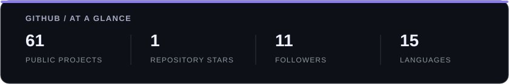
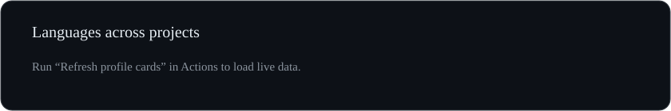

### 🇹🇷 High school student building products.

**Software Engineering · Artificial Intelligence · Robotics**

  &nbsp;&nbsp;
  &nbsp;&nbsp;
  

---

## A little about me

- **Founder** @ Çiçekli AppTech
- **Vice President** @ Çiçekli GameDev
- Building robots with **4th Dimension — FRC Team 6429**
- **Junior Software Developer** @ Lacivert Bilişim

---

## GitHub Overview

